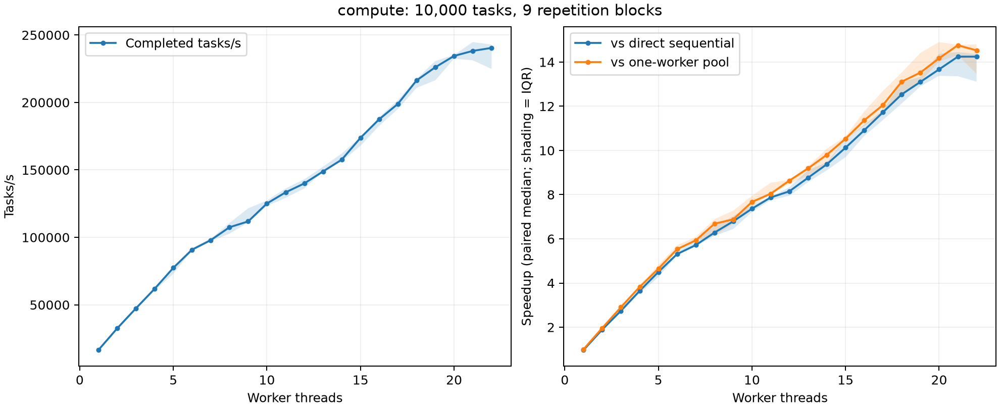

# Concurrent Task Executor

[](https://github.com/quanperfect/concurrent-task-executor/actions/workflows/ci.yml)

A fixed-size thread pool in C++20, using only the standard library. Workers take tasks from a shared FIFO queue, and `submit()` returns a typed `std::future` for each task.

- Move-only callables, arguments and results (e.g. `std::unique_ptr`)
- Exceptions thrown by a task are rethrown from `future.get()`; the worker keeps running
- `close()`, `wait_idle()` and `shutdown()` with graceful draining: accepted tasks always run, and threads are never detached
- Tested with ThreadSanitizer, AddressSanitizer/UBSan, failure injection and randomized stress runs

## Example

```cpp
#include <cte/task_executor.hpp>

#include <iostream>
#include <memory>

int main() {
    cte::task_executor pool(4);

    auto result = pool.submit(
        [](std::unique_ptr<int> value) { return *value * 2; },
        std::make_unique<int>(21));

    std::cout << result.get() << '\n'; // 42; get() rethrows task exceptions
    pool.shutdown();                  // stop accepting, finish queued work, join
}
```

More: [results and exceptions](examples/results_and_exceptions.cpp), [parallel buffer checksums](examples/parallel_checksums.cpp).

## Build and test

Requires CMake 3.25+ and a C++20 compiler. Tests use GoogleTest (installed, or downloaded with `-DCTE_FETCH_TEST_DEPS=ON`) and Python 3.11+.

```sh
cmake --preset gcc-debug -DCTE_FETCH_TEST_DEPS=ON
cmake --build --preset gcc-debug
ctest --preset gcc-debug
```

Presets: `gcc-debug`, `gcc-release`, `clang-debug`, `clang-tsan`, `clang-asan-ubsan`. CI builds and tests all five on Ubuntu 24.04.

To use the library from another CMake project:

```cmake
add_subdirectory(path/to/concurrent-task-executor)
target_link_libraries(your_target PRIVATE cte::cte)
```

## How it works

- **One mutex** protects the queue, the open/closed state and the count of running tasks. `submit()` and `close()` both take it, so a task is either accepted before closure or rejected with `cte::executor_closed`. It is never silently dropped.
- **Workers** wait on a condition variable until the queue has work or the pool is closed. They pop a task under the lock and run it outside the lock.
- **Type erasure:** each task is a `std::packaged_task` behind a small virtual interface. In C++20, `std::function` requires copyable callables, so it can't hold move-only ones.
- **Shutdown** closes the queue, lets the workers finish everything already accepted, and joins them. Concurrent `shutdown()` calls are safe. If a task calls `shutdown()` or `wait_idle()` on its own pool, it gets `std::logic_error` instead of a deadlock.

More detail: [design notes](docs/DESIGN.md), [API reference](docs/API.md).

## Performance

Measured on an Intel Core Ultra 7 155H laptop (16 cores / 22 threads, mixed performance and efficiency cores), GCC `-O3`, 10,000 tasks per batch, 9 repetitions per configuration:

| Workload | Result |
| --- | --- |
| CPU-bound tasks (~58 µs each), 22 workers | **14.2×** faster than a sequential loop (median) |
| Near-empty tasks, 1 worker | ~**0.7 µs** executor overhead per task |
| ~0.2 µs tasks | at least ~3.7× *slower* than a plain loop |



Small tasks don't benefit, because allocation, locking and the future cost more than the work itself. Absolute numbers also vary between sessions on a laptop: an earlier run measured 10.9× at 22 workers. The [benchmark notes](benchmarks/README.md) cover task size, pool start-up cost and queue-lock contention with several producers, and explain how to rerun everything.

## Testing

- Unit and concurrency tests (GoogleTest) for results, ownership, exceptions, FIFO order, closure races, concurrent shutdown and misuse
- Failure injection in a separate test build: thread creation failing partway through the constructor, and queue allocation failure
- A randomized stress test that races producers against shutdown and checks that every accepted task ran exactly once (also run for 10 minutes under ThreadSanitizer)

See [testing](docs/TESTING.md), including two ThreadSanitizer false positives caused by the uninstrumented standard library and how the tests avoid them.

## Limitations

- The queue is unbounded (no backpressure).
- No cancellation, priorities or work stealing.
- A task that blocks waiting for another task in the same pool can deadlock if every worker is busy.
- Tested on Linux with GCC and Clang only.

## Layout

```
include/cte/   public header
src/           implementation
tests/         unit, concurrency, fault-injection and stress tests
examples/      small usage examples
benchmarks/    benchmark harness, run_all.sh and recorded results
scripts/       benchmark analysis and plotting (Python)
docs/          design, API and testing notes
```

## License

[MIT](LICENSE)
