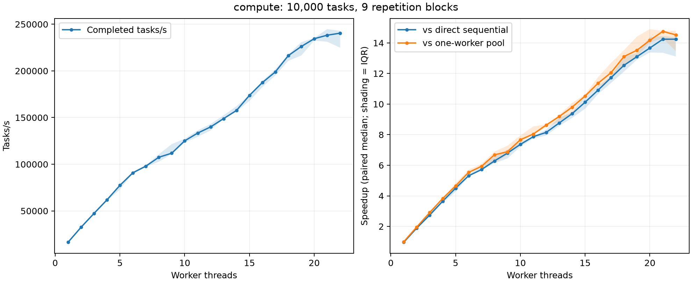

# Benchmarks

`cte_bench` runs a batch of tasks on a warmed-up pool. The timer covers everything from the first `submit()` until every result has been collected and the pool is idle. Each configuration runs 9 times. Inside each repetition the configurations run in random order, and every speedup is computed against the sequential loop from *the same* repetition. The tables show medians; IQR is the interquartile range. Every result is checked against a precomputed answer outside the timed region.

## Running

```sh
cmake --preset gcc-release
cmake --build --preset gcc-release
benchmarks/run_all.sh                       # about a minute; writes benchmarks/results/raw/*.csv
build/gcc-release/benchmarks/cte_bench --help
```

`run_all.sh` writes one CSV row per batch, and summaries go to `build/benchmark-summaries/`. `cte_bench` never overwrites an existing file, so to rerun into the same folder, delete the old CSVs first or pass another output directory. To redraw the chart, install matplotlib (`scripts/requirements.txt`) and run the `plot_benchmarks.py` command that `run_all.sh` prints.

| Workload | What each task does |
| --- | --- |
| `minimal` | Returns a number: pure overhead |
| `compute` | N rounds of a dependent xorshift/multiply chain |
| `mixed_compute` | Like `compute`, but every 8th task does 8× the work |
| `buffer_checksum` | FNV-1a over its own 4 KiB slice of a shared buffer |

## Results

Machine: Intel Core Ultra 7 155H laptop with 16 cores and 22 threads (6 P-cores with Hyper-Threading, 8 E-cores and 2 low-power E-cores), on AC power. Arch Linux 7.0.12, GCC 16.1.1 `-O3`. Measured on 2026-10-22 with this version of the code. The usual desktop apps were running, and no threads were pinned.

### Scaling

10,000 tasks of 30,000 rounds each (about 58 µs per task):



| Workers | Batch time | Tasks/s | Speedup vs sequential loop |
| ---: | ---: | ---: | ---: |
| sequential | 583 ms | 17.1k | — |
| 1 | 606 ms | 16.5k | 0.97× |
| 4 | 162 ms | 61.9k | 3.65× |
| 8 | 93.0 ms | 107k | 6.28× |
| 16 | 53.3 ms | 188k | 10.9× |
| 22 | 41.6 ms | 240k | 14.2× (IQR 13.1–14.4×) |

Scaling isn't linear, and on this CPU it isn't expected to be. Twelve of the 22 hardware threads are Hyper-Threading pairs on the six P-cores, and the E-cores are slower. Clock speeds also drop when every core is busy, while the sequential loop gets one P-core at full turbo. I didn't measure clock speeds, so treat that last point as a likely explanation, not a measured one.

The absolute numbers depend on the state of the laptop. Two full sweeps on 2026-10-22 gave 13.6× and 14.2× at 22 workers. An earlier sweep in September 2026, on an older version of the code, gave 10.9×, but its sequential loop was also about 8% slower (631 ms vs 583 ms). The loop doesn't use the executor at all, so the machine itself was running slower that day.

### Task size

Best speedup over the sequential loop among 1, 2, 4, 8, 16 and 22 workers, with 10,000 tasks per batch:

| Task | Work per task | Best speedup | At |
| --- | ---: | ---: | ---: |
| `minimal` | ~1 ns | 0.001× | 2 workers |
| `compute`, 100 rounds | 0.18 µs | 0.27× | 2 workers |
| `compute`, 1,000 rounds | 2.0 µs | 2.2× | 8 workers |
| `compute`, 5,000 rounds | 10 µs | 10.6× | 16 workers |
| `mixed_compute`, 5,000 rounds | 19 µs on average | 12.5× | 22 workers |
| `buffer_checksum`, 4 KiB | 3.9 µs | 4.3× | 8 workers |

With near-empty tasks and one worker, the pool costs **0.68 µs per task** more than the plain loop (IQR 0.64–0.77 µs). Each task pays for two allocations, three lock acquisitions, a condition-variable notification and a future. The break-even point for this kernel is somewhere between 0.2 and 2 µs of work per task. With tasks of a few microseconds, 8 workers beat 16 or 22. Most likely, the extra threads add contention on the single queue mutex and wakeups that the work can't pay for.

### Starting a pool

Creating a pool, running one empty task and destroying the pool takes 43 µs with 1 worker, 92 µs with 4 and 0.69 ms with 22. Most of that is starting and joining threads, so create the pool once and reuse it.

### Several producers

20,000 empty tasks, split evenly across P threads that all start submitting at the same moment:

| Workers | 1 producer | 2 | 4 | 8 |
| ---: | ---: | ---: | ---: | ---: |
| 4 | 816k tasks/s | 1.24M | 1.27M | 1.23M |
| 16 | 652k tasks/s | 785k | 774k | 958k |

A separate instrumented build (`cte_bench_probe`) times every 16th `submit()` around the queue mutex:

| Workers / producers | Wait for the lock, p50 / p95 | Lock held, p50 / p95 |
| --- | ---: | ---: |
| 4 / 1 | 33 ns / 1.1 µs | 24 ns / 66 ns |
| 4 / 8 | 141 ns / 8.8 µs | 53 ns / 84 ns |
| 16 / 1 | 32 ns / 1.1 µs | 23 ns / 66 ns |
| 16 / 8 | 157 ns / 16.5 µs | 54 ns / 98 ns |

The lock is only held for tens of nanoseconds, but the waiting tail grows quickly with more producers and workers. That is the cost of one shared queue. The instrumented build's batch times stayed within 4% of the normal build's.

Raw data is in [`results/raw/`](results/raw), one row per batch. The per-submission lock samples (about 5 MB) aren't committed; `run_all.sh` regenerates them.
